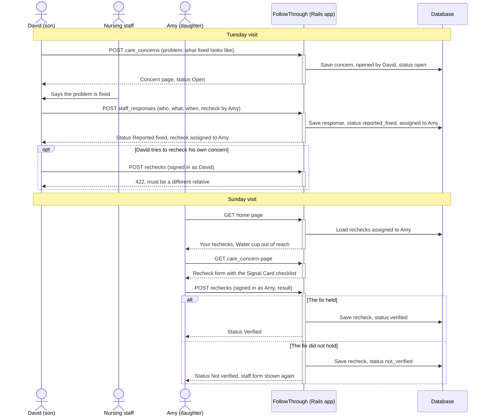

# FollowThrough: Because "Fixed" Should Mean Verified

FollowThrough helps families keep track of care concerns for someone in a nursing home or assisted living facility. When staff say they've fixed a problem, the family records what they said and marks the concern **Reported fixed**. On the next visit, a different relative checks the fix and records what they saw. The concern becomes **Verified** only when a relative confirms the fix.

**Live app:** https://followthrough-team-d64d6d9bc835.herokuapp.com/

## Team members

| Name | UNI |
| --- | --- |
| Zoe Li | wl3019 |
| Silin Jiang | sj3484 |
| Tianming Hao | th3016 |
| Jessica Song | ys3815 |

## Try it

Sign in with one of the demo accounts. All three are in Linda Chen's family. The password for each is `password123`.

| Account | Role | What to try |
| --- | --- | --- |
| amy@example.com | Relative | The home page shows a recheck assigned to Amy. Open it, check it against the Signal Card, and record the result. |
| david@example.com | Organizer | The Family page shows the invite code and lets David remove relatives. David opened the water cup concern, so he can't recheck it. |
| grace@example.com | Relative | Open the Meeting brief to compare what staff reported with what the family saw. |

## Features

Iteration 1 built the core workflow. Iteration 2 adds accounts, the shared family space, recheck assignments, visit logs, and the meeting brief.

| Feature | What a user can do | User stories |
| --- | --- | --- |
| Accounts | Sign up, sign in and out. Every page needs an account. | [6_accounts](features/6_accounts.feature) |
| Family space | Create a profile and become its organizer. Invite relatives with a code. Only members can see the profile. The organizer can update the facility and room, and removing a relative opens their waiting rechecks to the rest of the family. | [1_family_profile](features/1_family_profile.feature), [7_family_space](features/7_family_space.feature) |
| Signal Card | Add, edit, remove and search signals. Each one shows who last updated it. | [2_signal_card](features/2_signal_card.feature) |
| Visit log | Record how the resident seemed, which signals you noticed, and notes. Open a concern from a visit. | [10_visit_log](features/10_visit_log.feature) |
| Concerns | Record a problem and what "fixed" would look like. A progress bar shows where it stands. | [3_open_concern](features/3_open_concern.feature) |
| Staff responses | Record what staff said. The concern becomes Reported fixed and the recheck is assigned to another relative. | [4_staff_response](features/4_staff_response.feature), [8_recheck_assignment](features/8_recheck_assignment.feature) |
| Rechecks | The assigned relative sees the recheck first on their home page and checks it with the Signal Card checklist. If plans change, any relative can reassign the recheck to someone else or open it to anyone in the family. | [5_recheck](features/5_recheck.feature), [8_recheck_assignment](features/8_recheck_assignment.feature) |
| Meeting brief | Pick a period and see how many fixes staff reported, how many the family verified, and each concern side by side. Print it or save it as a PDF. | [9_meeting_brief](features/9_meeting_brief.feature) |

### How the core workflow fits together



Each step is covered by Cucumber: opening a concern (`3_open_concern.feature`), recording staff responses and assigning the recheck (`4_staff_response.feature`, `8_recheck_assignment.feature`), and rechecks (`5_recheck.feature`). The error case is the scenario "The relative who opened the concern cannot record its recheck" in `8_recheck_assignment.feature`.

### UI sketches

Zoe Li drew our UI sketches by hand. They are in [docs/ui-sketches.pdf](docs/ui-sketches.pdf).

| Sketch | Status |
| --- | --- |
| Signal Card | Implemented in iteration 1, search and "updated by" added in iteration 2 |
| Concern detail and recheck | Implemented in iteration 1, progress bar and recheck assignment added in iteration 2 |
| Family home (my rechecks first, open concerns) | Implemented in iteration 2 |
| Family space (members, roles, invites) | Implemented in iteration 2 with invite codes |
| Log a visit | Implemented in iteration 2 |
| Care plan meeting brief | Implemented in iteration 2 |

Photo uploads from the sketches are left out because Heroku does not keep uploaded files.

### Concern status

```
open ──staff response──> reported_fixed ──recheck──> verified ──recheck──> recurred
                               │
                               └──recheck──> not_verified
```

A new staff response moves an **Open**, **Not verified** or **Recurred** concern to **Reported fixed**. Once a fix is **Verified**, a recheck can only record that the problem came back. The relative who opened a concern can't record its recheck, and the recheck can only be assigned, or reassigned, to another member of the family.

See the rules in [CareConcern](app/models/care_concern.rb), [StaffResponse](app/models/staff_response.rb), [Recheck](app/models/recheck.rb) and [MeetingBrief](app/models/meeting_brief.rb), and the [model specs](spec/models/).

## Run locally

Install Ruby 3.3.8 and Bundler. You can use rbenv as in `hw-setup`. The app uses Rails 7.2 and SQLite locally.

```bash
git clone https://github.com/Zoeooeo/followthrough.git
cd followthrough
bundle config set --local without production  # skip the pg gem locally
bin/setup                                     # install gems, prepare databases, load sample data
bin/rails server
```

Open [localhost:3000](http://localhost:3000) and sign in with a demo account from [Try it](#try-it).

### Demo data

All names in the sample data and tests are fictional and used only for this class demo. This includes the resident (Linda Chen), her family members (David, Amy, Grace), the staff members, and the care facility (Greenview Nursing Home). Any resemblance to real people or facilities is coincidental.

## Tests

```bash
bin/rails db:test:prepare # First setup or after a new migration
bundle exec cucumber
bundle exec rspec
```

Cucumber and Capybara run through the family workflows. RSpec covers models and HTTP requests, including who can see and change each family's records. SimpleCov combines both runs in `coverage/index.html`.

## Deploy to Heroku

Heroku uses PostgreSQL. Before deploying, generate and commit `Gemfile.lock` with the Linux platform.

```bash
bundle lock --add-platform x86_64-linux --add-platform ruby
git add Gemfile.lock
git commit -m "Update Gemfile.lock for Heroku"
```

```bash
heroku login
heroku create
heroku addons:create heroku-postgresql:essential-0
git push heroku main
heroku run bin/rails db:seed
heroku open
```

The release command in [Procfile](Procfile) runs the migrations. If Heroku asks for `SECRET_KEY_BASE`, run `heroku config:set SECRET_KEY_BASE="$(bin/rails secret)"`.

### Upgrading from iteration 1

Iteration 2 replaces typed names with accounts, so concerns and rechecks from iteration 1 can't be carried over. Reset the database before deploying, then load the demo data again.

```bash
bin/rails db:reset                                              # local
heroku pg:reset DATABASE_URL --confirm YOUR-APP-NAME            # Heroku, before git push heroku main
```

## Project structure

```
app/models/          User, Membership, Resident, SignalItem, Visit, CareConcern, StaffResponse, Recheck, MeetingBrief
app/controllers/     Resource controllers. Family records are nested under /residents/:resident_id
                     and only load for members of that family.
app/views/           Server-rendered pages, no JavaScript required
db/migrate/          Table definitions
features/            Cucumber user stories and step definitions
spec/models/         Validation, permission and status-rule tests
spec/requests/       HTTP request tests, including sign-in and family access
```

## References

- Kevin Hakanson. "Sequence Diagrams enrich your understanding of distributed architectures." *AWS Architecture Blog*, August 19, 2022. https://aws.amazon.com/blogs/architecture/sequence-diagrams-enrich-your-understanding-of-distributed-architectures/
