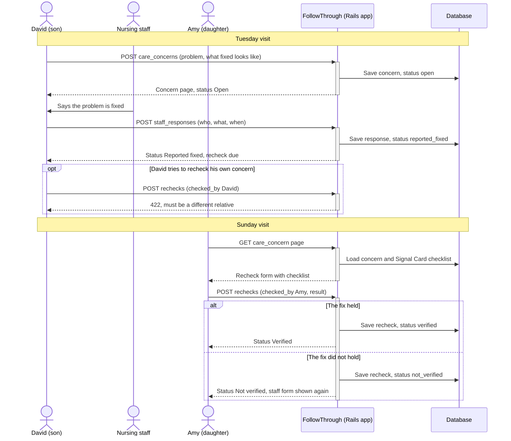

# FollowThrough: Because "Fixed" Should Mean Verified

FollowThrough helps families keep track of care concerns for someone in a nursing home or assisted living facility. When staff say they've fixed a problem, the family records what they said and marks the concern **Reported fixed**. On the next visit, a different relative checks the fix and records what they saw. The concern becomes **Verified** only when a relative confirms the fix.

## Team members

| Name | UNI |
| --- | --- |
| Zoe Li | wl3019 |
| Silin Jiang | sj3484 |
| Tianming Hao | th3016 |
| Jessica Song | ys3815 |

## Iteration 1

- [Family profile](features/1_family_profile.feature). Add a resident, browse all profiles, and see each resident's Signal Card and concerns.
- [Signal Card](features/2_signal_card.feature). Add, edit, or remove notes on how the resident shows a need and what to check.
- [Concerns](features/3_open_concern.feature). Record a problem, describe what "fixed" would look like, and link it to a signal if there is one.
- [Staff responses](features/4_staff_response.feature). Record who spoke to the family, what they said, and when.
- [Rechecks](features/5_recheck.feature). Use the linked Signal Card checklist, if there is one, and record what you found.

### How the core workflow fits together



Each step is covered by a Cucumber feature: opening a concern (`3_open_concern.feature`), recording staff responses (`4_staff_response.feature`), and rechecks (`5_recheck.feature`).

### Concern status

```
open ──staff response──> reported_fixed ──recheck──> verified ──recheck──> recurred
                               │
                               └──recheck──> not_verified
```

A new staff response moves a **Not verified** or **Recurred** concern back to **Reported fixed**. Once a fix is **Verified**, a recheck can only record that the problem came back. The relative who opened the concern can't record its recheck.

See the status rules and tests in [CareConcern](app/models/care_concern.rb), [StaffResponse](app/models/staff_response.rb), [Recheck](app/models/recheck.rb), and the [model specs](spec/models/).

Iteration 2 plans include sign-in, family invitations with roles, recheck assignments for the next visitor, a dashboard, and a one-page meeting brief.

## Run locally

Install Ruby 3.3.8 and Bundler. You can use rbenv as in `hw-setup`. The app uses Rails 7.2 and SQLite locally.

```bash
git clone https://github.com/Zoeooeo/followthrough.git
cd followthrough
bundle config set --local without production  # skip the pg gem locally
bin/setup                                     # install gems, prepare databases, load sample data
bin/rails server
```

Open [localhost:3000](http://localhost:3000) and select Linda Chen. The sample data has two signals and two concerns. Open **Water cup out of reach** to try a recheck.

### Demo data

All names in the sample data and tests are fictional and used only for this class demo. This includes the resident (Linda Chen), her family members (David, Amy, Grace), the staff members, and the care facility (Greenview Nursing Home). Any resemblance to real people or facilities is coincidental.

## Tests

```bash
bin/rails db:test:prepare # First setup or after a new migration
bundle exec cucumber
bundle exec rspec
```

Cucumber and Capybara run through the family workflows. RSpec covers models and HTTP requests. SimpleCov combines both runs in `coverage/index.html`.

## Deploy to Heroku

Heroku uses PostgreSQL. Before deploying, generate and commit `Gemfile.lock` with the Linux platform.

```bash
bundle lock --add-platform x86_64-linux --add-platform ruby
git add Gemfile.lock
git commit -m "Add Gemfile.lock for Heroku"
```

```bash
heroku login
heroku create
heroku addons:create heroku-postgresql:essential-0
git push heroku main
heroku open
```

The release command in [Procfile](Procfile) runs the migrations. To load the demo data, run `heroku run bin/rails db:seed`. If Heroku asks for `SECRET_KEY_BASE`, run `heroku config:set SECRET_KEY_BASE="$(bin/rails secret)"`.

See the [Heroku Rails 7 guide](https://devcenter.heroku.com/articles/getting-started-with-rails7) for deployment setup.

## Project structure

```
app/models/          Resident, SignalItem, CareConcern, StaffResponse, Recheck
app/controllers/     Resource controllers. Child routes are nested under /residents/:resident_id.
app/views/           Server-rendered pages, no JavaScript required
db/migrate/          Table definitions
features/            Cucumber user stories and step definitions
spec/models/         Validation and status-rule tests
spec/requests/       HTTP request tests
```
